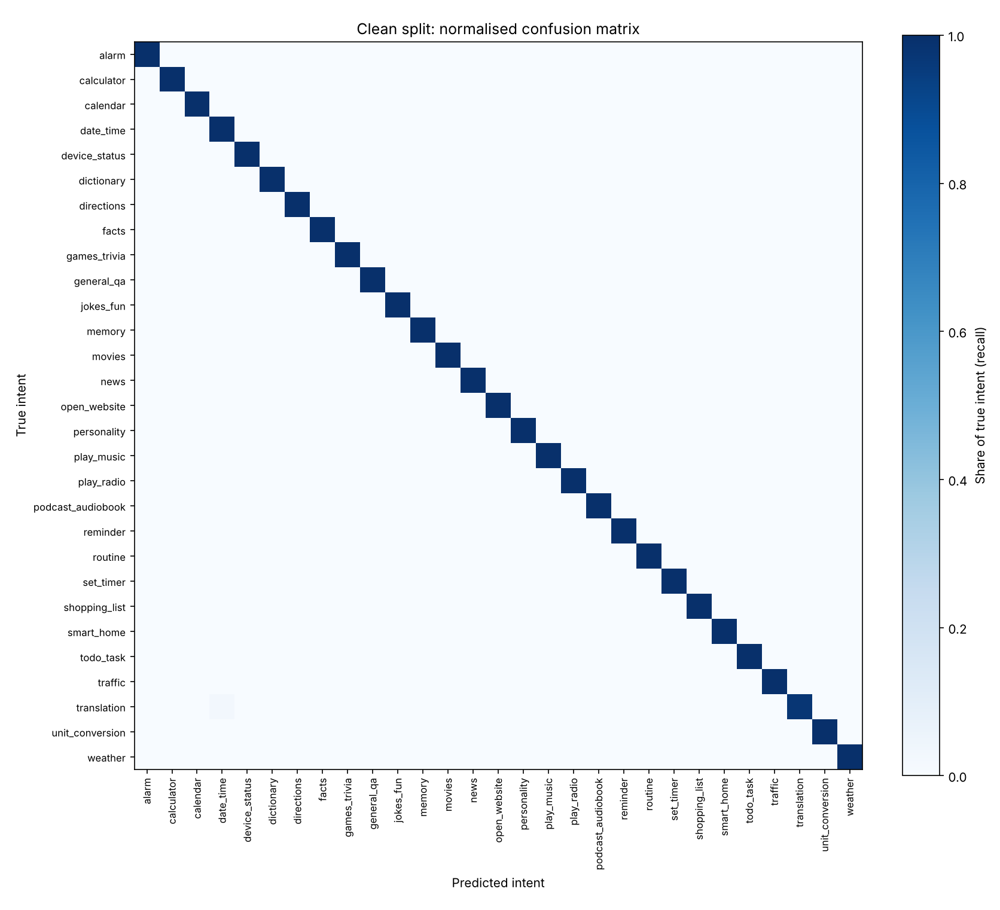
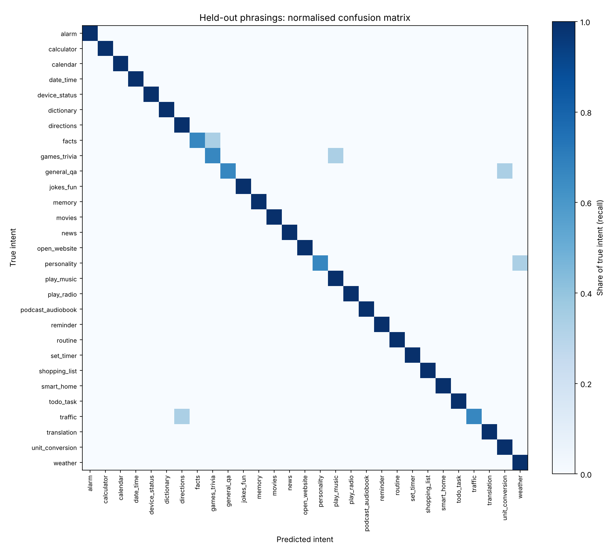

# Evaluation results

Generated by `va evaluate` from `data/alexa_data.csv`.

## Dataset audit

| | |
|---|---|
| Rows in CSV | 5700 |
| Row-id suffixes stripped | 0 |
| Unique sentences after cleaning | 5700 |
| Duplicate rate | 0.0% |
| Sentences with conflicting labels (removed) | 0 |
| Intents | 29 |

## 1. Naive split (original protocol, leaky)

Accuracy **99.9%**. Identical sentences appear in
both train and test, so this mostly measures memorisation.

## 2. Model comparison: 5-fold CV on de-duplicated data

| model | accuracy | accuracy_std | macro_f1 | macro_f1_std | fit_seconds |
|---|---|---|---|---|---|
| Linear SVM | 1.000 | 0.000 | 1.000 | 0.000 | 0.864 |
| Logistic Regression | 1.000 | 0.001 | 1.000 | 0.001 | 1.729 |
| MLP | 0.998 | 0.001 | 0.998 | 0.001 | 18.351 |
| Random Forest | 0.997 | 0.002 | 0.997 | 0.002 | 8.929 |
| Naive Bayes (baseline) | 0.997 | 0.002 | 0.997 | 0.002 | 0.065 |

Selected model: **Logistic Regression**. It is close to the best score, fast, and gives
calibrated probabilities, which the assistant needs for its confidence threshold.

Clean hold-out split: accuracy **99.9%**, macro F1 **0.999**
on 1140 unseen sentences.



<details><summary>Per-intent report</summary>

```
                   precision    recall  f1-score   support

            alarm       1.00      1.00      1.00        40
       calculator       1.00      1.00      1.00        40
         calendar       1.00      1.00      1.00        40
        date_time       0.98      1.00      0.99        40
    device_status       1.00      1.00      1.00        40
       dictionary       1.00      1.00      1.00        40
       directions       1.00      1.00      1.00        40
            facts       1.00      1.00      1.00        40
     games_trivia       1.00      1.00      1.00        40
       general_qa       1.00      1.00      1.00        40
        jokes_fun       1.00      1.00      1.00        40
           memory       1.00      1.00      1.00        20
           movies       1.00      1.00      1.00        40
             news       1.00      1.00      1.00        40
     open_website       1.00      1.00      1.00        40
      personality       1.00      1.00      1.00        40
       play_music       1.00      1.00      1.00        40
       play_radio       1.00      1.00      1.00        40
podcast_audiobook       1.00      1.00      1.00        40
         reminder       1.00      1.00      1.00        40
          routine       1.00      1.00      1.00        40
        set_timer       1.00      1.00      1.00        40
    shopping_list       1.00      1.00      1.00        40
       smart_home       1.00      1.00      1.00        40
        todo_task       1.00      1.00      1.00        40
          traffic       1.00      1.00      1.00        40
      translation       1.00      0.97      0.99        40
  unit_conversion       1.00      1.00      1.00        40
          weather       1.00      1.00      1.00        40

         accuracy                           1.00      1140
        macro avg       1.00      1.00      1.00      1140
     weighted avg       1.00      1.00      1.00      1140

```
</details>

## 3. Held-out phrasings (closest to real use)

- Utterances: **90**, written by hand, none appear in the training data
- Accuracy: **94.4%**, macro F1: **0.941**
- At confidence threshold 0.35: the assistant acts on **99%** of requests, and is right **95.5%** of the time when it does; the rest get a clarifying question.
- Misclassifications: `heldout_errors.csv` (5 rows)


